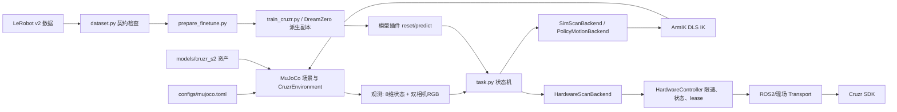

# Cruzr DreamZero 项目框架说明

本文说明当前仓库如何把 Cruzr S2 右臂任务从 MuJoCo 仿真迁移到服务器训练，再迁移到真机。代码默认任务是：**抓起桌面物体 → 把物体保持在机器人脸前的展示位 → 停留并采集一次观测 → 返回原位 → 松手并退离**。`scan` 是历史路点名称，兼容已有示教计划；默认任务不依赖二维码或条码解码。扫码可以在任务层后续启用，不属于当前动作成功条件。

## 1. 总体链路



项目把“任务编排”和“设备后端”分开。任务只调用具名路点、夹爪、等待、采集、归位核验和停止；仿真后端通过 IK 产生动作，真机后端使用现场示教的关节路点。这样可以复用动作顺序，但不会把仿真世界坐标冒充真机坐标。

| 运行环境 | 安装与运行内容 | 边界 |
| --- | --- | --- |
| 仿真环境 `.venv-sim` | Python 3.11/3.12，MuJoCo 4.0.1，NumPy 2.2.6，OpenCV | CPU 物理；渲染单独验收 EGL |
| 模型环境 `dreamzero-model` | 官方 DreamZero 依赖及数据工具，NumPy 1.26.4 | GPU 微调与推理；不安装整个仿真包 |
| 机器人 SDK 环境 | 厂家匹配的 ROS2/Python、消息包和 NumPy | 不加载 MuJoCo 或大模型，默认只读 |

这三种环境通过明确的数据/插件契约衔接，避免 NumPy、CUDA 和 ROS Python 版本相互污染。模型服务和仿真可使用独立进程；当前仓库提供插件调用边界，尚未提供经 Cruzr 权重验收的现成网络模型服务。

## 2. 目录与入口

| 路径 | 作用 | 关键入口 |
| --- | --- | --- |
| `src/cruzr_sim/config.py` | 读取并校验 TOML，解析相对资产路径、单位、限位、相机和展示位 | `load_config()` |
| `src/cruzr_sim/builder.py`、`scene.py` | 从导入资产生成可移植场景 XML、桌面/方块/相机 | `build_xml()` |
| `src/cruzr_sim/environment.py` | 500 Hz 物理、50 Hz 控制、15 Hz Pi0.5 采样、双相机观测、故障锁存 | `CruzrEnvironment` |
| `src/cruzr_sim/ik.py` | 右臂七自由度 DLS IK；使用独立 scratch `MjData` | `ArmIK.solve()` |
| `src/cruzr_sim/task.py` | 与设备无关的抓取、展示、归位、释放状态机 | `run_pick_present_return()` |
| `src/cruzr_sim/scan_sim.py` | 已知方块位置的仿真 oracle 后端；展示位由 `task.presentation.position` 指定 | `SimScanBackend` |
| `src/cruzr_sim/scanning.py` | 可选 OpenCV QR/ZBar 和 fixture 解码器 | `ImageScanner` |
| `src/cruzr_sim/policy.py` | 8 维动作块校验、15 Hz 累计采样时钟 | `validate_chunk()` |
| `src/cruzr_sim/policy_runtime.py` | DreamZero 插件包装、短前缀执行、阶段重规划 | `PolicyMotionBackend` |
| `src/cruzr_sim/real_robot.py` | SDK 单位/关节顺序、反馈控制器、示教计划后端、策略动作 API | `HardwareController` |
| `src/cruzr_sim/ros2_transport.py` | 延迟导入 ROS2 的只读/可写 transport 边界 | `Ros2Transport` |
| `src/cruzr_sim/dataset.py` | LeRobot v2 数据契约检查 | `check_contract()` |
| `src/cruzr_sim/finetune.py` | 在输出目录派生 DreamZero 本体配置和 collator 补丁 | `prepare_source()` |
| `src/cruzr_sim/deployment.py` | 仿真报告、任务报告、真机 profile/plan 的哈希收据 | `create_release()` |
| `scripts/run_present_task.py` | 默认展示任务入口，转发到统一任务运行器 | 仿真任务 |
| `scripts/run_scan_task.py` | 兼容入口；`--mode scan` 才启用扫码 | 仿真展示/扫码 |
| `scripts/validate_sim.py` | 服务器分阶段验收，含展示任务报告 | 仿真验收 |
| `scripts/robot_workflow.py` | probe/teach/shadow/execute；默认只读 | 真机流程 |
| `scripts/check_dataset.py`、`prepare_finetune.py`、`train_cruzr.py` | 数据检查、训练副本生成、计划/解析/启动 | 4×4090 服务器 |

`third_party/dreamzero` 是官方快照，保留来源和许可，不直接修改。微调时复制到 `outputs/.../dreamzero` 后只修改派生副本。

`mujoco_env.py` 中的 `MujocoCruzrRobot`/`MujocoCruzrSession` 与 `smoke_cruzr_pick_place.py` 保留历史控制器回归；后续任务与模型接入使用 `CruzrEnvironment`。旧调用一次推进若干物理步，与新接口固定的 50 Hz/15 Hz 语义不同，不能混用来解释动作频率。

## 3. 仿真物理与控制时钟

`configs/mujoco.toml` 的 `physics_dt=0.002` 对应 500 Hz 物理；`control_hz=50` 时一个控制周期包含 10 个物理步。`CruzrEnvironment.step()` 接受七个右臂关节绝对目标（rad）和夹爪几何开口（m），对目标变化做限速，再推进固定物理步数。物理推进结束后调用 `mj_forward`，保证物体位姿、接触和图像与当前关节时刻一致。

参考 Pi0.5 数据使用 15 Hz、8 维动作：七个 SDK 顺序关节角加 `right_gripper` 行程。`step_pi05()` 使用累计采样时钟将一个样本量化为 33/34 个物理步，避免每帧固定取整造成长期时钟漂移。整段动作块在执行前整体校验，支持最多 50 帧；学习策略运行时只执行短前缀并重新观测。仿真推理期间物理暂停，尚未模拟真机网络延迟。

状态永远读取实测/仿真 `qpos` 和夹爪状态，不用上一条指令代替状态。遇到 MuJoCo warning、非有限状态、时间不连续或回调异常会锁存 `faulted`，必须 `reset()` 后继续。

## 4. 任务阶段和成功条件

`run_pick_present_return()` 的阶段顺序如下：

1. `approach`：到 `pregrasp`，再到 `grasp`，夹爪保持打开。
2. `grasp`：闭合夹爪并由 backend 确认抓持。
3. `lift`：抬离桌面，仿真确认方块高度变化；真机依赖夹爪反馈和现场观察。
4. `present`：移动到 `scan` 路点。该名字保留是为了兼容已有 plan，实际目标来自 `[task.presentation]` 的世界坐标，是机器人脸前的安全展示位置；它不代表已经标定头部相机，也不要求接触人脸。
5. `capture`：停留 `dwell_s`，采集同步观测。采集是证据，不是当前任务成功条件。
6. `return`：经过 `return_high`、`return_low` 回到原位。
7. `release`、`retreat`：松手、退离、等待稳定。
8. `complete`：要求 `verify_return() is True` 才报告成功；缺少归位证据时运动可以完成，但任务失败。

运动/抓持/状态故障会立即进入 `fault`，不会自动返回或松手，避免在未知状态下继续移动。可选扫码流程 `run_pick_scan_return()` 只在 `--mode scan` 使用；解码失败仍可健康返回，但不会报告扫码成功。

后端必须实现 `move(waypoint,width,holding=False)`、`grip(width,grasp=False)`、`wait(seconds,holding=False)`、`capture()`、`verify_return()` 和 `stop()`。`TaskResult` 分开记录 `motion_complete`、`placement_verified`、`success`、阶段、错误与停止错误；未来扫码相关字段允许为空，不能把运动完成等同于整体任务成功。

## 5. 展示位配置与标定

仿真展示位在 `configs/mujoco.toml`：

```toml
[task.presentation]
position = [0.05, 1.02, 1.22]  # 世界系米，服务器上的起始候选值
yaw = 0.0
dwell_s = 1.0
```

启动 `SimScanBackend` 时使用初始腕部姿态与配置 yaw 做 IK 可达性预检；不可达会在任何抓取动作前失败。这个点是工程起始值，不是 PDF 或 SDK 给出的头部标定数据。服务器必须根据导入场景的头部相机/机器人位置检查画面，在报告中保存截图，然后调整该点和腕部姿态。真机完全采用现场示教的 `scan`（用户界面称 `present`）关节路点，不能复制仿真坐标。

## 6. 8 维接口、单位和相机

固定顺序为：

`R_shoulder_pitch_joint, R_shoulder_roll_joint, R_shoulder_yaw_joint, R_elbow_roll_joint, R_elbow_yaw_joint, R_wrist_pitch_joint, R_wrist_roll_joint, right_gripper`。

关节使用弧度；夹爪观测/动作契约使用 SDK 行程米。当前仿真几何最大开口 0.045 m，SDK 示例上限 0.05 m，输入会显式裁剪并记录 `gripper_target_clipped`；真实部署前必须用标定曲线替换线性映射。`wrist_left` 是历史数据键名，物理含义是右腕相机。

`observation.images.head_left` 当前由外部 `front_cam` 代替，`camera_calibrated=false`；`observation.images.wrist_left` 使用右腕近似相机。640×480 只是高效预览，不能替代真实内外参和视角标定。真机 profile 要求相机主题和 `camera_verified` 通过后才允许执行。

## 7. 数据与微调

数据入口只接受已核实的 LeRobot v2。`check_dataset.py` 检查 episode parquet、8 维状态/动作、rad/m 单位、时间戳顺序、双路视频帧数/fps、任务文本、有限值和关节限位；模板默认 `semantics_verified=false` 与 `observation_precedes_action=false`，防止未经确认的数据进入训练。用户数据目前在四卡服务器但路径和格式尚未提供，本仓库没有声称读取过它。

`prepare_finetune.py` 按 episode 拆分，生成带实际任务文本的独立副本，复制官方 DreamZero 源码并应用 Cruzr 本体 overlay（本体 id 33、双相机布局、动作 7+1、相对变换与语言 collator）。`train_cruzr.py` 默认只生成计划；`--compose` 解析配置，`--launch` 才启动。它检查 checkpoint、Wan2.1 组件和准备报告哈希，但不会下载权重。

4×4090 是训练资源入口，不等于已经验证过的显存方案。官方快照推理并行只接受 1/2 个进程，四进程 DDP 也不自动把冻结的 14B 基座切分到四张卡；需要在服务器上分别核对模型加载、ZeRO/offload、激活和峰值显存。所有训练输出、checkpoint、统计量和源码哈希要一起归档。

## 8. 真机适配与安全边界

真机 profile 记录 SDK 关节限位、夹爪端点、反馈时效、跟踪误差、命令频率和 commissioning 标记。`Ros2Transport(writable=False)` 默认不创建运动发布器；只有 `--mode execute --execute`、匹配 task mode 的发布收据、完整 commissioning、健康 supervisor 和现场示教 plan 才能进入可写流程。

`HardwareController` 的独立线程按目标限速发布，检查关节/夹爪/健康反馈新鲜度、跟踪误差、夹持状态和 2 秒 lease。异常锁存并发出 stop 请求；该 stop topic 是现场 supervisor 契约，不是本仓库声称已经核实的厂商急停。Python/ROS 仍需现场实测，不能把 `probe` 或 `shadow` 当成动作安全证明。

真机展示计划必须包含 `start` 加上 `pregrasp, grasp, lift, scan, return_high, return_low, retreat` 七个关节路点。执行前要求反馈与 `start` 的误差在容差内且速度接近零；缺少 start 或从任意姿态启动都会拒绝。`teach` 只记录当前反馈，不移动机器人；用户可用 `--waypoint present`，代码会保存为兼容的 `scan` 键。归位核验必须由治具、视觉或其他现场 verifier 提供，不能仅凭“松开了夹爪”判断成功。

## 9. 产物与可追溯性

服务器验收目录保存配置/资产哈希、依赖快照、源码哈希、每阶段日志、展示任务报告、策略契约报告和可选 RGB 图片。发布收据还绑定真机 profile、示教 plan、仿真报告与任务报告的 SHA-256；修改任何代码、配置或路点后都必须重新生成。

建议产物结构：

```text
outputs/server-baseline/
├── report.json
├── environment-freeze.txt
├── unittest.json
├── present-task/task-report.json
├── present-task/presentation-*.png   # 启用 --render 时保存
└── policy-contract/
outputs/cruzr-finetune-01/
├── prepare-report.json
├── datasets/train/  datasets/validation/
└── dreamzero/       # 官方源码派生副本
```

## 10. 当前实现、未验证事项和下一步

已实现：右臂 MuJoCo 环境、显式展示位、IK 预检、固定时钟、8 维动作契约、任务状态机、真机只读/可写边界、数据检查入口、训练派生入口和发布哈希收据。

按用户要求本机没有安装或运行 MuJoCo、ROS、DreamZero 或 GPU 训练，因此本轮没有声称仿真已通过。服务器首轮应执行 `docs/server-validation.md`：资产检查、严格 unittest、hold、重复抓放、双相机 RGB、展示位画面和 Pi0.5 时钟契约。仍待验证的关键项包括展示位可达性/相机标定、完整碰撞规划、真实 SDK/ROS 消息、独立停止、夹爪映射、数据转换、Hydra/权重加载、4×4090 显存和学习策略闭环。
